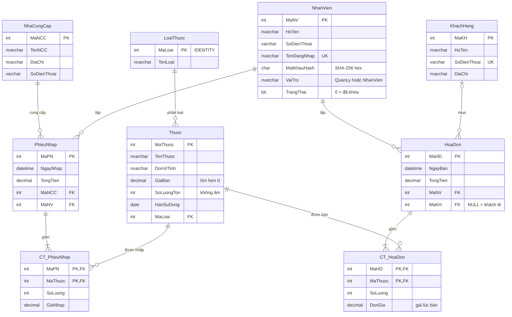

# Quản lý tiệm thuốc (IT008 – Lập trình trực quan)

Ứng dụng desktop **WPF** quản lý một tiệm thuốc chạy trên một máy: thuốc, loại thuốc, nhà cung cấp, khách hàng, nhân viên, nhập hàng, bán hàng, tồn kho và cảnh báo hạn dùng. Đồ án nhóm 5 người, môn IT008 – UIT.

- **Kế hoạch triển khai:** <https://claude.ai/artifact/LCC3wD3AjFPj7qw53AFKPM>
- **Bảng phân công task:** <https://claude.ai/artifact/EF8YAXpcuYpmtk17CnDwxp>

## Công nghệ

| Thành phần | Lựa chọn |
| --- | --- |
| IDE | Visual Studio 2022, template **WPF Application** |
| Nền tảng | .NET 8 (cả nhóm dùng cùng phiên bản) |
| CSDL | SQL Server Express + SSMS |
| Truy xuất dữ liệu | ADO.NET – NuGet `Microsoft.Data.SqlClient` |
| Kiến trúc | MVVM tự viết (`BaseViewModel`, `RelayCommand`), không dùng thư viện MVVM |
| Mã nguồn | Git + GitHub |

## Chức năng

| Mức | Chức năng |
| --- | --- |
| Bắt buộc | Đăng nhập, Đăng ký (vai trò mặc định Nhân viên), phân quyền 2 vai trò (Quản lý / Nhân viên) |
| Bắt buộc | Quản lý nhân viên, loại thuốc, thuốc (tìm theo tên, lọc theo loại), nhà cung cấp, khách hàng |
| Bắt buộc | Nhập hàng (phiếu nhiều dòng, tự cộng tồn), Bán hàng (hóa đơn nhiều dòng, chặn bán quá tồn và thuốc hết hạn) |
| Bắt buộc | Tồn kho và cảnh báo hạn dùng (tô màu sắp hết hàng, hết hạn, sắp hết hạn trong 30 ngày) |
| Bắt buộc | Kiểm tra nhập liệu ở mọi form, thông báo lỗi dễ hiểu |
| Nếu còn thời gian | Lịch sử hóa đơn |
| Không làm | Biểu đồ, ControlTemplate tùy biến, quản lý theo lô, tích điểm, in hóa đơn, nhiều chi nhánh |

Phạm vi được chốt cuối tuần 4, ý tưởng mới ghi vào mục "Hướng phát triển" của báo cáo.

## Cấu trúc thư mục

```text
PharmacyManagement/
├─ Models/          Thuoc.cs, LoaiThuoc.cs, NhaCungCap.cs, HoaDon.cs ...
├─ Data/            DbHelper.cs (chuỗi kết nối), ThuocRepository.cs ...
├─ ViewModels/      BaseViewModel.cs, RelayCommand.cs, ThuocViewModel.cs ...
├─ Views/           ThuocView.xaml, BanHangView.xaml ... (UserControl)
├─ Resources/       Styles.xaml, Colors.xaml (ResourceDictionary)
├─ MainWindow.xaml  Menu bên trái + ContentControl hiển thị View
└─ database/        01_schema.sql, 02_seed.sql
```

Mỗi màn hình đi qua đúng ba lớp: **View** gọi **ViewModel** qua Binding và Command, ViewModel gọi **Repository**, Repository là nơi duy nhất chứa câu SQL.

| Lớp | Quy tắc |
| --- | --- |
| Model | Lớp C# thuần, một lớp ứng với một bảng, cài `INotifyPropertyChanged` |
| Repository | Mỗi bảng một lớp: `GetAll()`, `Insert()`, `Update()`, `Delete()`. Luôn dùng tham số `@ten`, không nối chuỗi vào SQL |
| ViewModel | `ObservableCollection<T>` cho danh sách, `SelectedItem`, các lệnh `AddCommand`, `SaveCommand`, `DeleteCommand`. Không gọi `MessageBox`, không đụng tới control |
| View | Chỉ XAML và Binding. Code-behind chỉ cho việc thuần giao diện (focus, đóng cửa sổ). Không dùng sự kiện `Click` |

Kiểm tra nhập liệu theo một cách duy nhất: ViewModel có thuộc tính `ErrorMessage` bind vào một `TextBlock` màu đỏ, `CanExecute` của `SaveCommand` trả về `false` khi dữ liệu chưa hợp lệ.

## Cài đặt và chạy

1. Cài **Visual Studio 2022** (workload *.NET desktop development*), **SQL Server Express** với tên instance mặc định `SQLEXPRESS`, và **SSMS**.
2. Clone repo:
   ```bash
   git clone https://github.com/tring812/Visualize_Programming_IT008.git
   ```
3. Mở SSMS, chạy lần lượt `database/01_schema.sql` rồi `database/02_seed.sql` để tạo CSDL `PharmacyDB` và dữ liệu mẫu (có sẵn tài khoản Quản lý `admin`).
4. Mở solution bằng Visual Studio, nhấn **F5**.

Chuỗi kết nối chỉ nằm trong `Data/DbHelper.cs` và giống nhau trên mọi máy:

```text
Server=.\SQLEXPRESS;Database=PharmacyDB;Trusted_Connection=True;TrustServerCertificate=True
```

## Sơ đồ CSDL (ERD)

CSDL `PharmacyDB` gồm 9 bảng. Tồn kho nằm ngay trong `Thuoc.SoLuongTon`, hai bảng chi tiết nối hóa đơn và phiếu nhập với từng thuốc.



Đọc ký hiệu: `||--o{` là một – nhiều (bên nhiều có thể rỗng), `||--|{` là một – nhiều (ít nhất một dòng), `|o--o{` là bên một có thể không có (hóa đơn khách lẻ). Tiền dùng `DECIMAL(18,0)`, chữ tiếng Việt dùng `NVARCHAR`. Sơ đồ này là bản theo kế hoạch; khi nhóm duyệt ERD (task T04) và viết `01_schema.sql` thì cập nhật lại cho khớp.

## Quy tắc cơ sở dữ liệu

- Tồn kho lưu ở `Thuoc.SoLuongTon`: nhập hàng thì cộng, bán hàng thì trừ, không có bảng tồn kho riêng.
- Hóa đơn và phiếu nhập lưu trong một `SqlTransaction`; lỗi ở bước nào thì `Rollback` toàn bộ.
- `CT_HoaDon.DonGia` lưu giá tại thời điểm bán.
- Tiền dùng `DECIMAL(18,0)`; chữ tiếng Việt dùng `NVARCHAR` và `N'...'`.
- Mật khẩu băm SHA-256 lưu vào `MatKhauHash`, không lưu mật khẩu gốc.
- Không ai sửa bảng trực tiếp trong SSMS mà không cập nhật script trong `database/`.

## Quy ước làm việc nhóm

**Git**

- Nhánh `main` luôn chạy được. Mỗi task một nhánh: `feature/<id>-<ten-ngan>`, ví dụ `feature/T23-ban-hang`.
- Pull trước khi bắt đầu làm mỗi ngày. Commit nhỏ, ghi mã task: `T23: thêm giỏ hàng cho màn Bán hàng`.
- Xong thì tạo Pull Request, chuyển task sang **Chờ review**; trưởng nhóm duyệt và gộp. Không để nhánh quá 3 ngày chưa gộp.
- Mỗi người chỉ sửa file thuộc mảng của mình. Cần sửa `MainWindow.xaml`, `Styles.xaml` hay `database/*.sql` thì báo trong nhóm chat trước.

**Đặt tên**

- Bảng và cột: tiếng Việt không dấu, PascalCase (`SoLuongTon`).
- Lớp C#: `ThuocViewModel`, `ThuocRepository`, `ThuocView`. Command kết thúc bằng `Command`.

## Phân công

Mọi người tự nhận task trên bảng phân công chung (link ở đầu file). Mỗi task có mã `T01`, `T02`... dùng trong tên nhánh và commit message. Trạng thái: **Chưa làm → Đang làm → Chờ review → Xong**, hoặc **Bị chặn** khi task phụ thuộc chưa xong.

| Thành viên | MSSV | GitHub |
| --- | --- | --- |
| _(điền tên)_ | | |
| _(điền tên)_ | | |
| _(điền tên)_ | | |
| _(điền tên)_ | | |
| _(điền tên)_ | | |

## Dùng agent AI (Claude, Codex, Gemini)

Hướng dẫn kiểm tra và giải thích hai task nền tảng: [T08 — MVVM và T09 — DbHelper](docs/T08-T09.md).

Repo có sẵn skill theo chuẩn [Agent Skills](https://agentskills.io) để agent viết code đúng quy ước của nhóm:

| Skill | Dùng khi |
| --- | --- |
| `pharmacy-mvvm-screen` | Tạo hoặc sửa một màn hình (Model, Repository, ViewModel, View) |
| `pharmacy-database` | Sửa `01_schema.sql`, `02_seed.sql`, viết câu SQL hay transaction |
| `pharmacy-task-workflow` | Bắt đầu một task: tạo nhánh, commit, mở Pull Request |
| `pharmacy-review-checklist` | Tự kiểm tra trước khi tạo Pull Request |

- Bản gốc ở `.agents/skills/` — **Codex** và **Gemini CLI** đọc thư mục này. Gemini CLI cần bật Agent Skills trong settings, kiểm tra bằng `/skills list`.
- **Claude Code** đọc bản sao ở `.claude/skills/`. Sau khi sửa skill trong `.agents/skills/`, chạy `scripts/sync-skills.ps1` để chép sang.
- Quy ước chung cho agent nằm trong `AGENTS.md` (Codex), `GEMINI.md` và `CLAUDE.md` trỏ về file này.

Agent chỉ hỗ trợ: mỗi người phải tự giải thích được Binding, Command, ViewModel trong phần mình viết khi vấn đáp.

## Giấy phép

[MIT](LICENSE)
